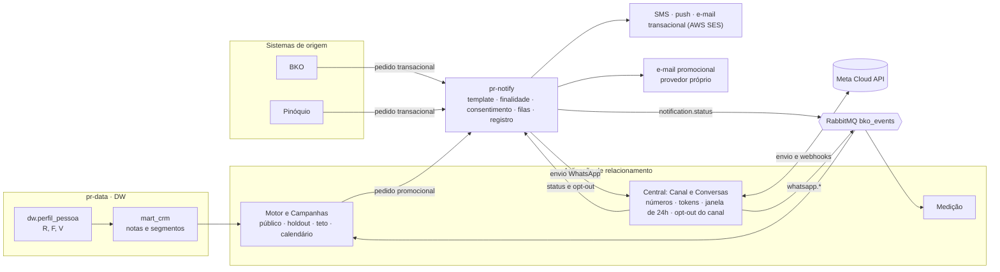
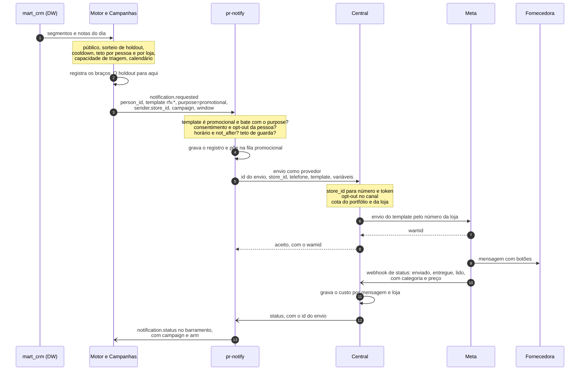
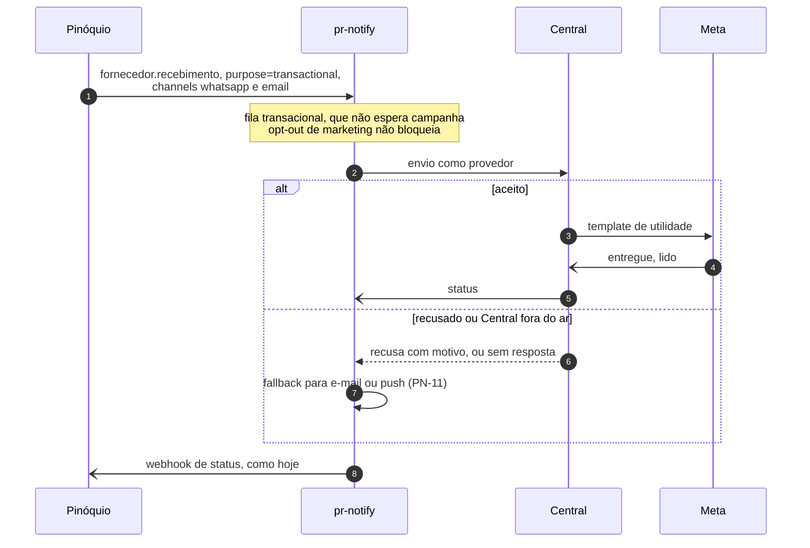
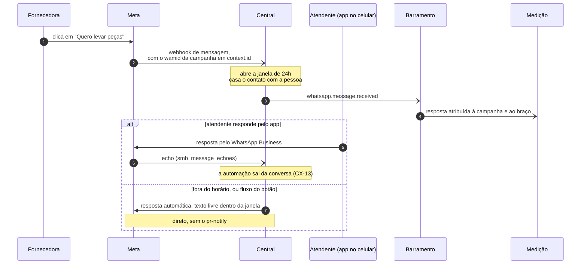
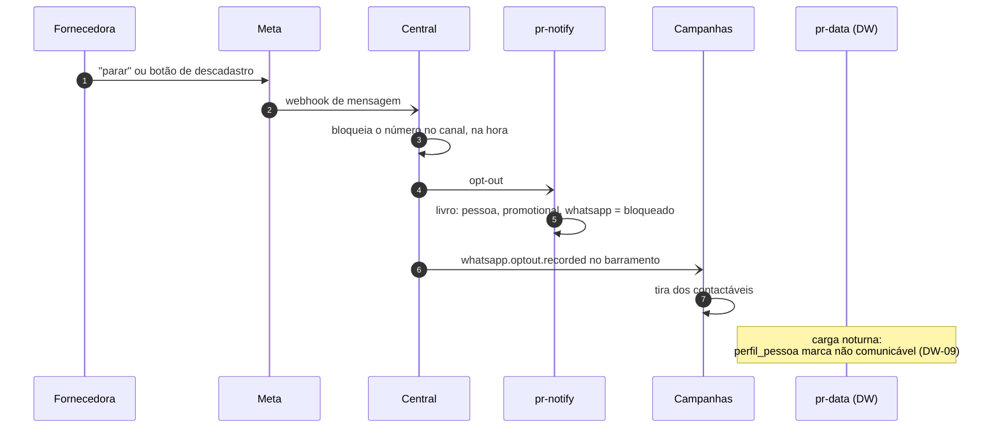
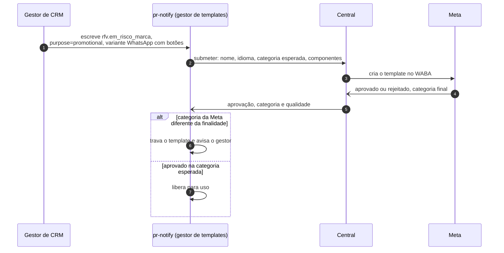
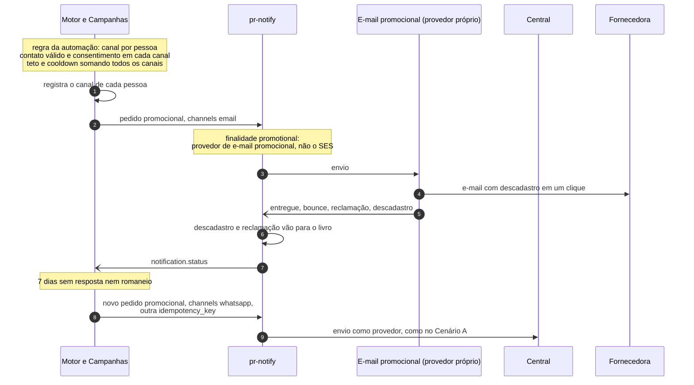

# Fluxos: motor, Central, pr-notify e Meta

> **O que está aqui.** Por onde o dado passa entre o motor do CRM, a Central, o pr-notify e a Meta, cenário a cenário, e quem responde por cada passo. Não decide nada novo: desenha o que já está em [[2026-10-20-pr-notify-braco-de-disparo]] (com o ajuste de 24/10), [[Interfaces — telas e contratos]] §2 e [[Frentes paralelas — tarefas até a PoC]]. Onde o desenho obriga uma escolha que a vault ainda não fez, ela aparece na §10.

---

## 0 · Leitura rápida

- **O pr-notify não fala com a Meta.** Só a Central fala com a Meta: ela tem o token de cada número (que vem do Embedded Signup), recebe os webhooks e sabe se a janela de 24h está aberta. Para o pr-notify, a Central é um provedor, como a Zenvia é no SMS. O motivo está na §9.
- **A aplicação de relacionamento aparece duas vezes no caminho.** O motor e as Campanhas pedem o envio ao pr-notify, e o pr-notify entrega pela Central, que está na mesma aplicação. São papéis diferentes: quem escolhe o público não fala com a Meta, e quem fala com a Meta não escolhe o público.
- **O que a empresa inicia passa pelo pr-notify. A resposta a uma conversa aberta pela pessoa não passa.** A automação reativa (fora do horário, botão, fluxo pedido pelo atendente) responde direto da Central para a Meta.
- **O opt-out é barrado em três lugares, de propósito.** As Campanhas filtram o público, o pr-notify bloqueia por pessoa e finalidade, e a Central bloqueia o número no canal. O DW só espelha, à noite, e nunca é o que impede um envio.
- **O holdout nunca sai da aplicação.** O pr-notify só recebe o braço tratado. Quem não recebeu fica registrado nas Campanhas, e a Medição compara os dois.
- **No promocional, o canal é escolha das Campanhas, sem fallback** (ajuste de 26/10). Cada pedido leva um canal só. O e-mail promocional sai por um provedor próprio, não pelo AWS SES, que fica com o transacional (§8).

---

## 1 · Quem é quem

### Quem guarda o quê

| Dado | Dono | Quem mais lê |
|---|---|---|
| R, F, V e características da pessoa | `dw.perfil_pessoa` (pr-data) | motor |
| Nota, faixa e segmento | `mart_crm`, escrito pelo motor | Campanhas, aba Fornecedores |
| Campanha, braços e quem caiu no holdout | Campanhas (aplicação) | Medição |
| Canal escolhido para cada pessoa da campanha | Campanhas (aplicação) | Medição |
| Template, finalidade e versão | pr-notify | Central, para submeter à Meta |
| Livro de consentimentos (pessoa × finalidade × canal) | pr-notify | Campanhas (público), ficha da pessoa |
| Registro do envio (um por chave × canal) | pr-notify | quem pediu (webhook), barramento |
| Número da loja, WABA, token, qualidade do número | Central | ninguém de fora |
| Conversa, mensagem, janela de 24h, mídia, custo | Central | caixa, ficha, Medição |
| Opt-out do WhatsApp | Central (bloqueia) e pr-notify (livro) | Campanhas |
| "Não comunicável" por pedido do titular | registro da solicitação (lugar em aberto, [[2026-10-24-solicitacoes-do-titular]]) | pr-notify e Central bloqueiam; o DW espelha |

---

## 2 · O fio que liga pedido, status e resposta

Cada salto acrescenta um identificador. A atribuição só fecha se cada um souber voltar ao anterior.

| Identificador | Quem cria | Vai até | Para quê |
|---|---|---|---|
| `person_id` | grafo de pessoa (DW) | Campanhas, pr-notify, Central | consentimento, ficha, atribuição |
| `campaign_id` e `arm` | Campanhas | pr-notify, que devolve no status | atribuição por campanha e braço |
| `idempotency_key` (ex.: `rfv:camp-000123:person:…`) | quem pede (Campanhas, BKO, Pinóquio) | pr-notify | não enviar duas vezes o mesmo pedido |
| id do envio no pr-notify | pr-notify | Central | o status volta casado por ele |
| `wamid` | Meta | Central, e dela para o pr-notify | casar status, resposta e clique de botão com a mensagem enviada |

A resposta da fornecedora a um botão chega com o `wamid` da mensagem original (`context.id`). É assim que a Central sabe que a resposta é àquela campanha: `wamid` → envio no pr-notify → `campaign_id` e `arm`.

---

## 3 · Cenário A: campanha promocional por WhatsApp

| Passo | O que acontece | Quem responde | Trilha |
|---|---|---|---|
| 1–3 | escolher quem recebe, sortear o holdout, respeitar teto, cooldown e capacidade da loja | motor e Campanhas | MOT e aplicação |
| 4 | montar o pedido com os campos de campanha | Campanhas | aplicação |
| 5–6 | conferir a finalidade, o consentimento e a janela; filas separadas por prioridade | pr-notify | NTF |
| 7–10 | traduzir loja em número, barrar opt-out do canal, respeitar o limite da Meta, enviar | Central | CEN |
| 12–14 | receber o status, gravar o custo e devolver ao pr-notify | Central | CEN |
| 15 | publicar o status com os metadados de campanha | pr-notify | NTF (PN-09) |

---

## 4 · Cenário B: transacional do Pinóquio ou do BKO por WhatsApp

O motor não entra. O gatilho fica onde o fato acontece.

O promocional **não** tem fallback: se o WhatsApp falhar, o envio fica como falha e as Campanhas veem isso no status. Mudar de canal é decisão delas (§8).

---

## 5 · Cenário C: a fornecedora responde ou clica no botão

Aqui o caminho é reativo e não passa pelo pr-notify.

O que a Central publica no barramento é o que a Medição usa para fechar o ciclo: envio (`notification.status`, do pr-notify) e resposta (`whatsapp.message.received`, da Central). A volta com peças vem depois, dos fatos de romaneio no DW.

---

## 6 · Cenário D: opt-out

| Camada | O que barra | Por quê ficar aqui também |
|---|---|---|
| Campanhas | tira do público | não gasta cota nem custo com quem não vai receber |
| pr-notify | promocional sem consentimento, por pessoa, finalidade e canal | vê todos os canais e todos os sistemas que pedem envio, inclusive o BKO |
| Central | qualquer envio ao número com opt-out no canal | último ponto antes da Meta; vale mesmo se o livro atrasar |
| DW | nada, só espelha | carrega à noite; não pode ser a trava ([[2026-10-24-solicitacoes-do-titular]]) |

---

## 7 · Cenário E: template novo

A autoria fica no pr-notify e a conversa com a Meta fica na Central (CAN-09). Com **WABA única**, uma submissão vale para todos os números; com uma WABA por loja, seriam 130 submissões por template ([[Canal, números e modelo de cobrança]]). Isso depende de MTA-03.

---

## 8 · Cenário F: campanha em mais de um canal

O canal é decisão das Campanhas, por pessoa, e cada pedido leva um canal só. O pr-notify não troca de canal no promocional. No exemplo, a regra é "e-mail primeiro; sem resposta nem romaneio em 7 dias, WhatsApp para quem tem número e consentimento".

| Regra | Onde |
|---|---|
| Qual canal cada pessoa recebe, e em que ordem | Campanhas (CAM-01, CAM-11) |
| Teto e cooldown contam contato em qualquer canal | Campanhas (CAM-05) |
| Alcance e custo por canal antes de enviar | simulador (CAM-03), sobre a cobertura do D-1 |
| Canal como braço de experimento, quando houver poder | Medição (MED-06) |
| Um canal por pedido promocional, sem fallback | pr-notify confere |
| Provedor pela finalidade: AWS SES no transacional, provedor próprio no promocional | pr-notify (PN-16) |
| SMS no promocional | não usar |

O push segue o mesmo caminho do e-mail, pelo OneSignal, para quem usa o app. Por que o e-mail promocional fica fora do SES: [[pr-notify como braço de disparo]] §3.

---

## 9 · Por que o pr-notify não chama a Meta direto

A alternativa seria o pr-notify ter um driver que chama a Meta e a Central só receber webhooks.

| | **pr-notify → Central → Meta** (decidido) | **pr-notify → Meta, webhooks na Central** |
|---|---|---|
| Token de cada número | só na Central | nos dois serviços |
| Status | volta para quem enviou | chega na Central e precisa ser repassado ao pr-notify do mesmo jeito |
| Janela de 24h, qualidade do número, cota do portfólio | quem envia sabe | o pr-notify precisaria perguntar à Central antes de cada envio |
| Opt-out no canal | barrado no último ponto | depende de o livro do pr-notify estar em dia |
| Custo | um salto a mais na chamada | um serviço a menos no envio |

O salto a mais é barato. Partir o envio e a confirmação em dois serviços sai caro.

---

## 10 · O que os diagramas deixam em aberto

- [ ] **O status volta pela chave do pr-notify, não só pelo `wamid`** (CEN-13). O webhook da Meta pode chegar antes de o pr-notify gravar o `wamid` da resposta. Casando pelo id do envio, essa corrida não existe.
- [ ] **Quem traduz `store_id` em número.** A proposta é a Central, que é dona do cadastro dos números. O pr-notify manda só a loja (PN-07, CEN-13).
- [ ] **O que "parar" bloqueia.** Só o promocional, ou o canal inteiro? A vault diz que o transacional só para com bloqueio total do canal, mas não diz qual gesto da pessoa leva a qual bloqueio. Conferir também como a Meta devolve o envio quando a pessoa bloqueia a empresa ou o marketing pelo próprio app.
- [ ] **Dependência circular.** Se a aplicação de relacionamento cair, cai também o WhatsApp transacional do BKO e do Pinóquio. O fallback (PN-11) cobre o transacional; o promocional espera ou expira em `not_after`. Precisa de alerta no pr-notify quando a Central recusar ou não responder.
- [ ] **Holdout na Medição.** O holdout não sai da aplicação. As Campanhas precisam registrar "teria recebido em tal data" para cada pessoa do holdout, senão a Medição não tem a data de corte do braço de comparação.
- [ ] **Provedor do e-mail promocional.** Critérios em [[pr-notify como braço de disparo]] §3 (PN-16). Até ele existir, o promocional por e-mail que já roda (reengajamento e aniversário) segue pelo SES.
- [ ] **Reengajamento e aniversário.** Hoje saem do BKO direto para o pr-notify. Pelo JOR-04, passam pelas Campanhas (Cenário A). Até lá, competem com o RFV pela mesma pessoa sem teto comum.

## Relacionamentos

- [[2026-10-20-pr-notify-braco-de-disparo]]
- [[pr-notify como braço de disparo]]
- [[Interfaces — telas e contratos]]
- [[Frentes paralelas — tarefas até a PoC]]
- [[2026-10-24-solicitacoes-do-titular]]
- [[Pessoa como entidade central]]
