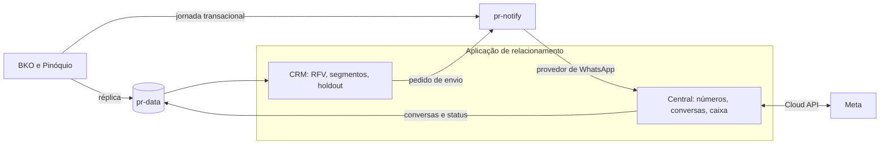

Programa de relacionamento com o fornecedor · RFV · revisão de 24/10/2026

# Frentes paralelas do RFV

O que anda junto com o pr-data até a PoC da Central de WhatsApp: homologação na Meta, plano B de provedor, jurídico, lojas, mandato e o desenvolvimento que já pode começar. Cada tarefa tem uma entrega só, quem faz, de que depende e em que sprint entra.

Rascunho para revisão do time. Depois de revisado, vira lista no monday (PR Projetos). Nota de origem na vault: 10-Projetos/rfv-fornecedores/detalhamento/Frentes paralelas — tarefas até a PoC.

- **26/10**Sprint 1 começa
- **09/11**Sprint 2
- **23/11**Sprint 3
- **30/11**PoC em 1–2 lojas
- **15/12**Data-limite do provedor
- **04/01/27**Espelho em 5–10 lojas
- **08/02/27**Primeiro disparo de campanha
- **02/08/27**Decisão de rede

Onde estamos

## O material que já existe

O planejamento está desenhado. Falta transformar em tarefas com dono, e é isso que esta página faz.

| Peça | O que tem | Estado |
| --- | --- | --- |
| Enquadramento | Programa de relacionamento com três objetivos (comunicação, fornecimento, atração) e quatro linhas: caixa de entrada, jornada do fornecedor, campanhas RFV e atração | base do plano |
| Arquitetura | Central de WhatsApp da rede na franqueadora; Central e CRM numa aplicação nova, fora do BKO; pr-notify como braço de disparo; pessoa como entidade central | Central aceitademais em proposta |
| Frente 1 | 19 decisões de canal, números, provedor, plataforma, jurídico e custo (I-01 a I-19), cada uma com recomendação e quem decide | 11 para decidir agora |
| Frente 2 | Cinco trabalhos que andam sem esperar terceiros e o plano das três primeiras sprints | começa 26/10 |
| Etapas | Marcos M0 a M7, do dado em leitura até a decisão de rede, com porteira entre eles | cronograma-base |
| Funcionalidades | Catálogo por módulo (Canal, Caixa, Pessoa, Dados, Jornada, Campanhas, Medição, Atração) e o mínimo que fecha cada marco | rascunho |
| pr-data | Base de dados da rede: esquema v2, chaves, língua e glossário, opções de motor (PostgreSQL no RDS, \~US$ 172/mês) | falta glossário e prova do motor |
| Pendências de agosto | Conversa com o Diego (gestor de CRM), conversa com o Matheus (fases e porteiras), contrato da Thays | sem andamento |

Como as peças se ligam

## Quem faz o quê

**pr-data**Dimensões e fatos da rede, fora da produção. O CRM é o primeiro consumidor.

**CRM**Decide o promocional: público, holdout, teto por pessoa, calendário. Guarda o estado de campanha.

**pr-notify**Porta única de envio, em todos os canais: template, finalidade, consentimento, registro.

**Central**Dona do canal WhatsApp: números das lojas, webhooks da Meta, caixa de entrada, opt-out, custo.

Decidido em 24/10/2026

## Dois tipos de automação

Se a conversa começa com o fornecedor, quem responde é a Central. Se começa com uma decisão nossa, é o motor de campanhas, e o envio passa pelo pr-notify.

|  | Reativa | Proativa (campanha) |
| --- | --- | --- |
| Começa com | mensagem do fornecedor ou do cliente | decisão nossa, a partir do dado do pr-data |
| Exemplos | resposta fora do horário, clique num botão, palavra "SAIR", fluxo pedido pelo atendente | fornecedores esfriando de uma marca numa loja; sequência do novo fornecedor |
| Mora em | Central, módulo de Conversas | motor do CRM, módulo de Campanhas |
| Caminho | Central → Meta | motor → pr-notify → Central → Meta |
| Mensagem | texto livre, dentro da janela de 24h | template aprovado, categoria marketing, com opt-in |
| Custo | \~US$ 0,0068 por resposta pela API; pelo app é grátis | tarifa de marketing por mensagem entregue |

**Onde as duas se encontram**O template da campanha leva botões ("Quero agendar entrega", "Ver meu saldo"). O clique chega como mensagem recebida, abre a janela de 24h, e a Central conduz dali.

**O echo tira o robô da conversa**Quando o atendente responde pelo app, o echo avisa a Central, e a automação para naquela conversa.

**No número da loja, automação só em três casos**Fora do horário, resposta a botão de mensagem nossa e fluxos que o atendente dispara. O menu completo fica no número central.

**Mensagem de ausência em um lugar só**A do app continua funcionando no celular. A loja que usar a da Central desliga a do app, senão o fornecedor recebe duas.

Conferido em 24/10/2026

## O que a documentação da Meta diz hoje

A Frente 1 deixava os passos de Tech Provider para conferir no início da fase A. Conferido. As linhas destacadas mudam o plano.

| Fato | O que muda |
| --- | --- |
| O marketing já tem portfólio empresarial verificado (anúncios Meta e Instagram). O primeiro passo para virar Tech Provider é verificar a empresa, e ele aparece concluído quando o app é criado num portfólio verificado. | A verificação, que costuma levar dias ou semanas, já está feita. Falta confirmar o CNPJ e decidir se a Central fica nesse portfólio (MTA-01, MTA-02). |
| Depois da verificação, o App Review pede acesso avançado a `whatsapp_business_messaging` e `whatsapp_business_management`. | Sem a segunda permissão, a API recusa qualquer chamada em conta de WhatsApp de outra empresa. |
| O App Review pede dois vídeos, e eles podem ser gravados com as ferramentas da própria Meta: o cURL do "API Setup" e o WhatsApp Manager criando template. | A homologação não espera a Central ficar pronta. Dá para submeter na S2. |
| O app precisa de ícone, categoria e política de privacidade publicada. | A política de privacidade entra no jurídico já na S1 (JUR-01). |
| As versões 2 e 3 do Embedded Signup saíram do ar em 15/10/2026, e já existe a versão 5, com a coexistência ligada por padrão. | Construir na versão vigente. A vault ainda fala em v4. |
| Na coexistência há 24 horas, depois do onboarding, para sincronizar o histórico (180 dias). Histórico e contatos sincronizam uma vez só, e a mídia vem só dos últimos 14 dias. | A ingestão de histórico precisa estar pronta e testada antes da primeira loja real. Se falhar, a loja é desligada e refaz o onboarding. |
| Um número em coexistência não sai pela API. Quem desconecta é a loja, no app: Configurações → Conta → Plataforma empresarial → Desconectar. | O desligamento de uma loja depende de ela agir (I-14). A PoC precisa descobrir o que a franqueadora consegue fazer sozinha. |
| Em coexistência, a plataforma não opera lista de transmissão (fica só leitura), Canais, etiquetas, respostas rápidas, mensagem de ausência, catálogo, chamadas e grupos. | O Canal do WhatsApp, candidato a substituir a lista de transmissão, não é operável pela plataforma. Resta saber se continua no app. |
| O WhatsApp para Windows não é aceito como aparelho vinculado, e o onboarding desconecta todos os aparelhos vinculados. | Confirma o critério de escolha das lojas da PoC. |
| A cobrança do WhatsApp exige meio de pagamento próprio no portfólio, separado do pagamento de anúncios. | Cadastrar antes da PoC (MTA-12). |

Segunda, 26/10

## O que começa primeiro

Em ordem de prazo de retorno: o que demora mais para voltar vai primeiro.

1. GOV-01

   Alocar capacidade para a Central, o pr-notify e os dados. As três trilhas estão "a alocar", e o cronograma supõe que andam juntas.
2. MTA-01 a MTA-03

   Confirmar o CNPJ do portfólio de anúncios, decidir se a Central fica nele e checar se Tech Provider e lojas podem dividir o mesmo portfólio.
3. JUR-01 · JUR-02

   Política de privacidade (o app precisa dela) e texto do aceite no romaneio, o item do programa que mais demora a dar retorno.
4. OPS-01

   Questionário às lojas. Demora a voltar, e é dele que sai a escolha das lojas da PoC.
5. RFI-01 a RFI-03

   Questionário aos BSPs. O plano B não pode começar do zero em 15/12.
6. NTF-01 · CEN-01 · CEN-13

   Alinhar as branches do pr-notify, criar o repositório da aplicação e escrever o contrato entre os dois.
7. DW-02

   Aprovar o orçamento e subir a instância da prova do motor do pr-data.

Todas as frentes

## Quadro por sprint

Clique numa tarefa para ver o que ela precisa e o que ela destrava. Os filtros valem para o quadro e para as listas abaixo.

começa segunda condicional pré-requisito da selecionada destravada pela selecionada T1 teste da PoC que a tarefa atende

Nenhuma tarefa selecionada.

Para revisar linha a linha

## Tarefas por frente

Para a reunião

## Riscos e perguntas em aberto

### Riscos de prazo

- **Capacidade**Central, pr-notify e dados estão sem time definido. Se dividirem as mesmas pessoas, as três atrasam juntas.
- **PoC em 30/11**Para entrar em loja real, o App Review precisa estar aprovado e o termo do piloto assinado. Se a Meta atrasar, o plano B precisa estar respondido em 15/12.
- **Histórico em 24 horas**A sincronização roda uma vez só. A ingestão precisa estar testada antes da primeira loja.
- **Gestor de CRM**Sem esse nome, as campanhas (M4) não têm quem defina segmentos, escreva templates e leia o incremental.

### Perguntas para o time

- **Portfólio de anúncios ou portfólio dedicado ao WhatsApp?**O de anúncios economiza a verificação. Um dedicado separa acessos e ativos.MTA-02 · I-01
- **Qual CNPJ é o titular: franqueadora ou PRTEC?**A PRTEC já fatura o cashback. Trocar de titular depois exige migrar o portfólio.I-01
- **Tech Provider e lojas podem ficar no mesmo portfólio?**Se não puderem, o app fica num portfólio e os números das lojas em outro.MTA-03 · I-02
- **Quem conduz o jurídico, e o termo sai antes de 30/11?**Política de privacidade, aceite no romaneio, termo do piloto e LGPD dependem da mesma pessoa.JUR-01 a JUR-05
- **Base legada: só quem deu opt-in, ou legítimo interesse?**Define o tamanho da base com que a jornada e as campanhas começam.JUR-03 · I-13
- **Qual time é dono da aplicação de relacionamento?**Sem dono, o repositório não nasce.GOV-05

Fontes da Meta, conferidas em 24/10/2026:

- [Become a Tech Provider](https://developers.facebook.com/docs/whatsapp/solution-providers/get-started-for-tech-providers)
- [Onboarding customers as a Tech Provider](https://developers.facebook.com/documentation/business-messaging/whatsapp/embedded-signup/onboarding-customers-as-a-tech-provider)
- [Onboarding WhatsApp Business app users (coexistence)](https://developers.facebook.com/documentation/business-messaging/whatsapp/embedded-signup/onboarding-business-app-users)

Não há na documentação limite de clientes por janela nem prazo da análise.